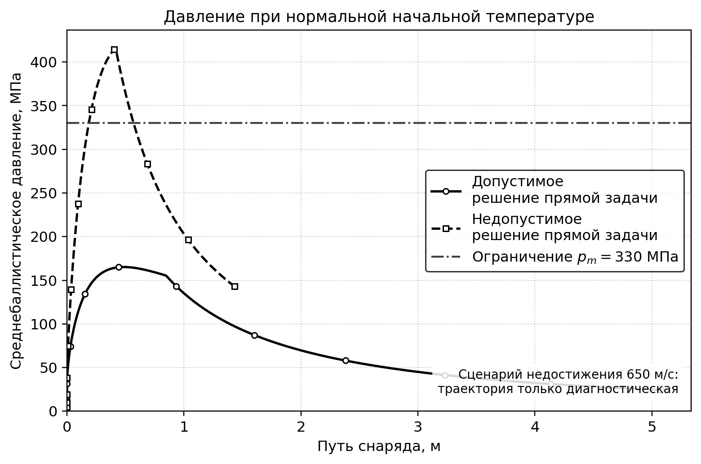
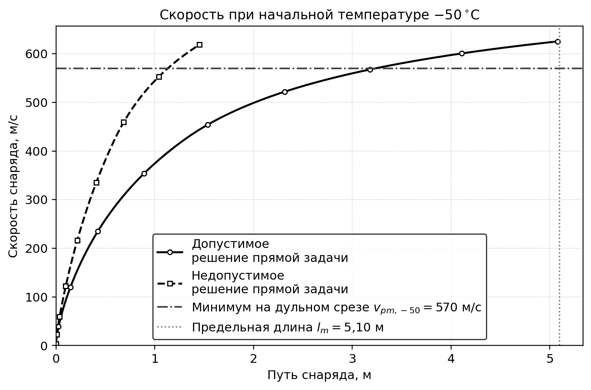
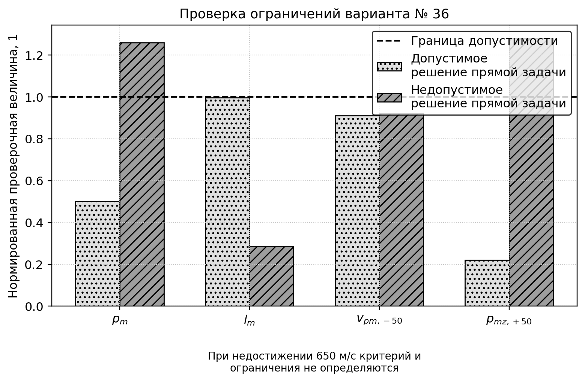
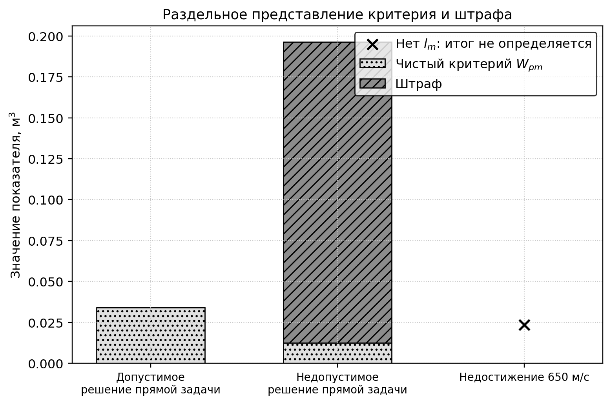

<style>
table th,
table td {
  text-align: center !important;
  vertical-align: middle !important;
}

table th {
  font-weight: normal !important;
}
</style>

<div class="title-page">

<div class="title-organization">

**ОБРАЗОВАТЕЛЬНАЯ ОРГАНИЗАЦИЯ: ______________________________**  
**КАФЕДРА / ПОДРАЗДЕЛЕНИЕ: _________________________________**

</div>

<div class="title-main">

**ЛАБОРАТОРНАЯ РАБОТА № 1**  
по дисциплине «Информационные технологии при проектировании РиСО»

**Markdown, LaTeX и воспроизводимый отчёт  
по прямому баллистическому расчёту**

Вариант № 36

</div>

<div class="title-authors">

Выполнил: студент группы __________  
**Андрей Барышев**

Проверил: __________________________

</div>

<div class="title-city">____________________ — 2026</div>

</div>

# ВВЕДЕНИЕ {.structural}

Цель лабораторной работы — разработать воспроизводимую программу прямого
расчёта внутренней баллистики для варианта № 36, проверить вычисление критерия,
ограничений и штрафа, а также исследовать поведение программы на допустимом,
недопустимом решениях, при недостижении целевой скорости и в близкой паре точек
по разные стороны границы допустимости. Расчёт выполняется нульмерной
термодинамической моделью библиотеки `pyballistics` версии 1.2.1. Исходные данные
варианта взяты из методического пособия [1], требования к исследованию — из
задания на лабораторную работу [2].

Работа ограничена прямой баллистической задачей. Поиск оптимального решения и
сравнение оптимизаторов не выполняются. Марка и масса метательного заряда
используются как параметры отдельных контрольных решений, а не как найденный
оптимум.

# 1 Вариант и организация расчётов {.section}

## 1.1 Исходные данные и математическая постановка

В таблице 1 приведены исходные данные варианта № 36. В программном коде все
величины хранятся в единицах СИ; в таблицах результатов давление дополнительно
переведено в мегапаскали для читаемости.

<div class="table-title">Таблица 1 — Исходные данные варианта № 36</div>

| Величина | Обозначение | Значение |
|:---:|:---:|:---:|
| Калибр орудия | $d$ | $0{,}085$ м |
| Масса снаряда | $q$ | $9{,}54$ кг |
| Требуемая дульная скорость | $v_{pm}$ | $650$ м/с |
| Тип орудия | — | нарезное |
| Модель внутренней баллистики | — | нульмерная |
| Давление воспламенителя | $p_{ign\_0}$ | $5{,}0\cdot10^6$ Па |
| Давление форсирования | $p_0$ | $3{,}0\cdot10^7$ Па |
| Марка основного пороха | — | 8/1 тр |

Методическое пособие не назначает варианту конкретную марку основного пороха,
поэтому для контрольных решений выбрана марка 8/1 тр из базы
`pyballistics`. Порохом-воспламенителем является ДРП. Начальный объём каморы
принят равным $W_0=4{,}0\cdot10^{-3}$ м³, коэффициент фиктивности массы снаряда
$\varphi_1=1{,}02$, нормальная температура $T_0=293{,}15$ К.

Чистый критерий представляет объём канала ствола вместе с каморой и вычисляется
по формуле (1):

$$
W_{pm}=W_0+Sl, \qquad S=0{,}26\pi d^2. \qquad \text{(1)}
$$

где $W_{pm}$ — критерий, м³; $W_0$ — начальный объём каморы, м³; $S$ — площадь
поперечного сечения канала, м²; $l$ — длина хода снаряда до дульного среза, м;
$d$ — калибр, м. Направление улучшения критерия — минимизация.
Длина $l=l_m$ не задаётся заранее: она определяется в базовом расчёте как
координата достижения требуемой скорости 650 м/с.

Для варианта проверяется система ограничений (2):

$$
\begin{aligned}
p_m(293{,}15\,\mathrm{K}) &\le 3{,}30\cdot10^8\ \mathrm{Па},\\
l_m &\le 60d=5{,}10\ \mathrm{м},\\
v_{pm}(223{,}15\,\mathrm{K}) &\ge 570\ \mathrm{м/с},\\
p_{mz}(323{,}15\,\mathrm{K}) &\le 1{,}10\cdot10^8\ \mathrm{Па}.
\end{aligned} \qquad \text{(2)}
$$

где $p_m$ — максимальное среднебаллистическое давление; $l_m$ — длина ведущей
части канала; $v_{pm}$ — дульная скорость; $p_{mz}$ — дульное
среднебаллистическое давление. Температуры 223,15 К и 323,15 К соответствуют
условиям $-50\,^{\circ}$C и $+50\,^{\circ}$C.

## 1.2 Организация безопасного прямого расчёта

Функция `run_ballistics_safe` формирует словарь параметров и вызывает
`pyballistics.ozvb_termo`. Базовый расчёт при 293,15 К ведётся не до заранее
заданной длины, а до $v_p=650$ м/с (`stop_reason = v_p`). Одновременно действуют
защитные пределы: $x_p\le5{,}10$ м, $p_m\le1{,}0\cdot10^9$ Па и не более
200 000 шагов. Последний предел давления является только защитой решателя и не
заменяет проверяемое ограничение 330 МПа.

Если скорость 650 м/с достигнута, конечная координата базовой траектории
фиксируется как $l_m$. Затем два расчёта при 223,15 К и 323,15 К выполняются до
одного и того же среза $x_p=l_m$. Поэтому холодная скорость и горячее дульное
давление относятся к геометрии, полученной при нормальной температуре, а не к
исходно назначенной длине.

Вызов находится внутри `try-except`. Помимо исключений проверяются причина
останова, наличие обязательных массивов `t`, `x_p`, `v_p`, `p_m`, одинаковая
длина расчётных слоёв, конечность чисел и монотонность времени и координаты.
Для каждого запуска сохраняется фактический `stop_reason`. Если базовый расчёт
останавливается по защитному пределу до 650 м/с, программа выводит конечные
координату и объём $W_{diag}=W_0+Sx_{final}$ только как диагностику. Этот объём
не считается критерием: $l_m$, $W_{pm}$, ограничения, штраф и допустимость
остаются неопределёнными, холодный и горячий расчёты не запускаются. Такому
исходу назначается отдельный статус «цель не достигнута», отличный и от
вычислительной ошибки, и от рассчитанного нарушения ограничения.

Для успешно рассчитанного решения возвращаются конечная скорость,
максимальное и конечное давления, причина остановки и массивы траектории.
Статус прямого расчёта не содержит оценки допустимости. Поэтому физически
рассчитанное превышение ограничения не смешивается с вычислительной ошибкой.

## 1.3 Штрафная функция

Ограничения имеют разные размерности, поэтому перед объединением вычисляется
безразмерное нарушение. Для верхней и нижней границ используются формулы (3):

$$
r_i=
\begin{cases}
\max\!\left(0,\dfrac{g_i-g_i^{\max}}{g_i^{\max}}\right),
& g_i\le g_i^{\max},\\[6pt]
\max\!\left(0,\dfrac{g_i^{\min}-g_i}{g_i^{\min}}\right),
& g_i\ge g_i^{\min}.
\end{cases} \qquad \text{(3)}
$$

где $g_i$ — рассчитанное значение; $g_i^{\max}$ или $g_i^{\min}$ — предел;
$r_i$ — нормированное нарушение. При выполненном ограничении $r_i=0$.

Изолированная квадратичная штрафная функция и итоговый показатель определены
формулами (4) и (5):

$$
P=\alpha W_{pm}\sum_{i=1}^{4}r_i^2, \qquad \alpha=100. \qquad \text{(4)}
$$

$$
J=W_{pm}+P. \qquad \text{(5)}
$$

где $P$ — штраф, м³; $\alpha$ — безразмерный коэффициент масштаба; $J$ —
штрафованный показатель, м³. Значения $W_{pm}$ и $P$ хранятся раздельно.
Ошибка прямого расчёта не получает искусственного бесконечного штрафа: для неё
$P$ и $J$ не определяются.

## 1.4 Замысел вычислительной проверки

Выбраны три исходных сценария и дополнительная близкая пара. Допустимое решение
должно подтвердить достижение целевой скорости в пределах 60 калибров и нулевой
штраф. Недопустимое решение использует увеличенную массу заряда и проверяет
обнаружение нарушений давления, включая исправленный предел горячего дульного
давления 110 МПа. Третий сценарий имеет недостаточный заряд: базовый расчёт
штатно доходит до защитной координаты, но не до 650 м/с. Он непосредственно
проверяет диагностическую ветвь и запрет подмены критерия конечным объёмом. Этот
сценарий запускается между двумя рассчитываемыми, поэтому выполнение последнего
также подтверждает продолжение программы.

Близкая пара служит отдельной проверкой чувствительности штрафной функции. В
обеих точках используются порох 8/1 тр, объём каморы $W_0=0{,}006500$ м³ и все
общие условия расчёта; изменяется только масса заряда на 0,001 кг: 2,312 кг в
точке А и 2,313 кг в точке Б. Пара выбрана так, чтобы горячее дульное давление
оказалось соответственно немного ниже и немного выше 110 МПа, тогда как три
остальных ограничения сохраняют запас.

Профили давления и скорости показывают ход прямого расчёта и соответствующие
границы. Нормированные столбцы позволяют совместно проверить все четыре
разноразмерных ограничения. Отдельная диаграмма критерия и штрафа подтверждает,
что чистый критерий не заменяется штрафованным значением.

# 2 Контрольные решения и результаты {.section}

## 2.1 Выбранные решения

Назначение и входные параметры контрольных решений приведены в таблице 2.
Указанная координата 5,10 м является общим защитным пределом базового расчёта,
а не заранее принятой длиной ствола. Искомая длина определяется отдельно для
каждой массы заряда по достижению 650 м/с.

<div class="table-title">Таблица 2 — Контрольные решения прямой задачи</div>

| Сценарий | Марка пороха | Масса заряда, кг | $W_0$, м³ | $x_{safety}$, м | Назначение |
|:---:|:---:|:---:|:---:|:---:|:---:|
| Допустимое решение прямой задачи | 8/1 тр | 1,350 | 0,004000 | 5,10 | Проверка нулевого штрафа |
| Решение без достижения целевой скорости | 8/1 тр | 1,200 | 0,004000 | 5,10 | Диагностический защитный останов |
| Недопустимое решение прямой задачи | 8/1 тр | 2,000 | 0,004000 | 5,10 | Проверка двух ограничений давления |
| Точка А у границы горячего давления | 8/1 тр | 2,312 | 0,006500 | 5,10 | Нулевой штраф непосредственно до границы |
| Точка Б у границы горячего давления | 8/1 тр | 2,313 | 0,006500 | 5,10 | Появление штрафа после изменения заряда на 1 г |

## 2.2 Численные результаты

Основные результаты сведены в таблицу 3. Тире означает, что величина не
определяется: диагностическая конечная координата сценария без достижения
650 м/с не принимается за $l_m$ и не подставляется в критерий.

<div class="table-title">Таблица 3 — Результаты проверки сценариев</div>

| Сценарий | $l_m$, м | $W_{pm}$, м³ | $P$, м³ | $J$, м³ | Допустимость |
|:---:|:---:|:---:|:---:|:---:|:---:|
| Допустимое решение прямой задачи | 5,081797 | 0,033990134 | 0,000000000 | 0,033990134 | да |
| Недопустимое решение прямой задачи | 1,453986 | 0,012580674 | 0,183689866 | 0,196270540 | нет |
| Решение без достижения целевой скорости | — | — | — | — | не определяется |
| Точка А у границы горячего давления | 2,051575 | 0,018607334 | 0,000000000 | 0,018607334 | да |
| Точка Б у границы горячего давления | 2,049563 | 0,018595459 | $1{,}712659\cdot10^{-7}$ | 0,018595630 | нет |

В таблице 4 приведены исходные размерные значения каждого ограничения,
исправленные пределы и нормированные нарушения. Для сценария без $l_m$ такая
проверка намеренно не выполняется.

<div class="table-title">Таблица 4 — Поэлементная проверка ограничений</div>

| Сценарий | Ограничение | Значение | Предел | $r_i$ | Результат |
|:---:|:---:|:---:|:---:|:---:|:---:|
| Допустимое | $p_m$ | 165,201 МПа | $\le330$ МПа | 0,000000 | выполнено |
| Допустимое | $l_m$ | 5,081797 м | $\le5{,}10$ м | 0,000000 | выполнено |
| Допустимое | $v_{pm,-50}$ | 625,361 м/с | $\ge570$ м/с | 0,000000 | выполнено |
| Допустимое | $p_{mz,+50}$ | 24,333 МПа | $\le110$ МПа | 0,000000 | выполнено |
| Недопустимое | $p_m$ | 415,905 МПа | $\le330$ МПа | 0,260320 | нарушено |
| Недопустимое | $l_m$ | 1,453986 м | $\le5{,}10$ м | 0,000000 | выполнено |
| Недопустимое | $v_{pm,-50}$ | 618,743 м/с | $\ge570$ м/с | 0,000000 | выполнено |
| Недопустимое | $p_{mz,+50}$ | 140,769 МПа | $\le110$ МПа | 0,279720 | нарушено |
| Точка А | $p_m$ | 286,463 МПа | $\le330$ МПа | 0,000000 | выполнено |
| Точка А | $l_m$ | 2,051575 м | $\le5{,}10$ м | 0,000000 | выполнено |
| Точка А | $v_{pm,-50}$ | 623,208 м/с | $\ge570$ м/с | 0,000000 | выполнено |
| Точка А | $p_{mz,+50}$ | 109,880 МПа | $\le110$ МПа | 0,000000 | выполнено |
| Точка Б | $p_m$ | 286,664 МПа | $\le330$ МПа | 0,000000 | выполнено |
| Точка Б | $l_m$ | 2,049563 м | $\le5{,}10$ м | 0,000000 | выполнено |
| Точка Б | $v_{pm,-50}$ | 623,206 м/с | $\ge570$ м/с | 0,000000 | выполнено |
| Точка Б | $p_{mz,+50}$ | 110,033 МПа | $\le110$ МПа | 0,000303 | нарушено |

На рисунке 1 сопоставлены базовые профили давления при нормальной температуре.
Обе кривые заканчиваются при 650 м/с, но в разных координатах $l_m$. Рисунок
нужен для проверки величины максимума и визуального подтверждения нарушения
ограничения недопустимым решением.



<div class="figure-caption">Рисунок 1 — Среднебаллистическое давление при нормальной начальной температуре</div>

Максимальное давление допустимого решения равно 165,201 МПа и имеет запас до
предела 330 МПа. Для увеличенного заряда получено 415,905 МПа: ограничение
нарушено на 85,905 МПа. Диагностическая траектория третьего сценария не участвует
в проверке ограничений и отмечена на рисунке пояснением.

На рисунке 2 показана скорость при температуре $-50\,^{\circ}$C до найденного
для каждого решения среза. Горизонтальная линия обозначает минимальную скорость
на срезе, а вертикальная — предельную длину 5,10 м.



<div class="figure-caption">Рисунок 2 — Скорость снаряда при начальной температуре −50 °C</div>

Оба исходных рассчитываемых решения выполняют температурное ограничение скорости:
625,361 м/с и 618,743 м/с превышают требуемые 570 м/с. Таким образом,
недопустимость второго решения вызвана не недостатком холодной дульной скорости.

Для совместной проверки ограничений на рисунке 3 каждое из них приведено к
форме «значение не более единицы». Для верхней границы построено отношение
$g_i/g_i^{\max}$, для нижней — $g_i^{\min}/g_i$. Штриховая линия единица
отделяет допустимую область.



<div class="figure-caption">Рисунок 3 — Нормированная проверка ограничений варианта № 36</div>

У допустимого решения все столбцы не превышают единицу. У недопустимого решения
границу пересекают два столбца: $415{,}905/330=1{,}26032$ и
$140{,}769/110=1{,}27972$. Нормированные нарушения по формуле (3) равны
$r_p=0{,}260320$ и $r_{pz,+50}=0{,}279720$; нарушения длины и холодной скорости
равны нулю. Так новый предел 110 МПа влияет и на классификацию, и на штраф.

Разделение чистого критерия и штрафа представлено на рисунке 4. Сценарию без
достижения целевой скорости намеренно не сопоставлен итоговый столбец.



<div class="figure-caption">Рисунок 4 — Чистый критерий и штрафная добавка</div>

Для допустимого решения $P=0$, поэтому $J=W_{pm}=0{,}033990$ м³. Для
недопустимого решения чистый критерий равен 0,012581 м³, но два нарушения дают
квадратичный штраф 0,183690 м³ и итоговый показатель 0,196271 м³. Результат
подтверждает, что чистый критерий сохранён отдельно от штрафной добавки.

## 2.3 Чувствительность штрафа вблизи границы

Подробное сопоставление близкой пары приведено в таблице 5. Знак отклонения
$\Delta p=p_{mz,+50}-110$ МПа показывает сторону границы. Кроме массы заряда,
все исходные условия точек А и Б одинаковы.

<div class="table-title">Таблица 5 — Близкая пара по разные стороны границы горячего дульного давления</div>

| Точка | $\omega$, кг | Изменение $\omega$, кг | $p_{mz,+50}$, МПа | $\Delta p$, МПа | $r_{pz,+50}$ | $P$, м³ |
|:---:|:---:|:---:|:---:|:---:|:---:|:---:|
| А, допустимая | 2,312 | — | 109,880236 | −0,119764 | 0,000000000 | 0,000000000 |
| Б, недопустимая | 2,313 | +0,001 | 110,033383 | +0,033383 | 0,000303481 | $1{,}712659\cdot10^{-7}$ |

В точке А оператор $\max(0,\ldots)$ в формуле (3) возвращает нуль, поэтому
штраф отсутствует. После увеличения заряда всего на 1 г горячее дульное давление
превышает предел на 0,033383 МПа. Единственное ненулевое нарушение равно
$r_{pz,+50}=0{,}000303481$, и по квадратичной формуле (4) возникает малый, но
измеримый вклад $P=1{,}712659\cdot10^{-7}$ м³. Это демонстрирует отсутствие
скачка штрафа на границе: при переходе от выполненного ограничения к слабому
нарушению штраф плавно возрастает от нуля.

При этом максимальное давление в точках А и Б составляет соответственно
286,463 и 286,664 МПа, длина — 2,051575 и 2,049563 м, а холодная дульная
скорость — 623,208 и 623,206 м/с. Следовательно, классификация точки Б и её
штраф обусловлены только пересечением предела $p_{mz,+50}$.

## 2.4 Недостижение целевой скорости

При массе заряда 1,200 кг базовый расчёт останавливается с сохранённой причиной
`stop_reason = x_p`. В защитной координате $x_{final}=5{,}100000$ м скорость
равна 604,993 м/с, то есть 650 м/с не достигнуты. Программа выводит
$W_{diag}=0{,}034097557$ м³, но явно сообщает, что диагностический объём не
использован как критерий. Поэтому в таблице 3 отсутствуют $l_m$, $W_{pm}$,
штраф и признак допустимости, а расчёты при −50 и +50 °C не выполняются.

После диагностического сценария программа выполняет недопустимый сценарий и
строит все рисунки. Это подтверждает, что ожидаемый защитный останов не вызывает
аварийного завершения и не смешивается с обычным нарушением ограничения.

## 2.5 Границы проведённой проверки

Исследование охватывает штатный расчёт, одновременное нарушение двух ограничений
давления и недостижение целевой скорости по защитному пределу координаты.

Пять точек не доказывают корректность библиотеки `pyballistics` во всём диапазоне
параметров и не заменяют сопоставление с экспериментом. Не исследованы смеси
порохов, другие марки, устойчивость к шагу интегрирования и неопределённость
термодинамических параметров. Выбранное допустимое решение не объявляется
оптимальным.

# ЗАКЛЮЧЕНИЕ {.structural}

Реализован воспроизводимый прямой расчёт варианта № 36 нульмерной моделью
`pyballistics` 1.2.1. Длина ствола теперь определяется базовым расчётом при
+20 °C по достижению 650 м/с и затем без изменения используется при −50 и
+50 °C. Безопасная обёртка сохраняет причину останова и отличает защитный останов
от физически рассчитанного нарушения ограничений.

Чистый критерий $W_{pm}$, четыре ограничения, нормированные нарушения, штраф и
штрафованный показатель вычисляются раздельно. Исправленный предел
$p_{mz,+50}\le110$ МПа учтён в нормировании и штрафе. Допустимое решение имеет
нулевой штраф. Увеличенный заряд нарушает максимальное и горячее дульное
давления и получает положительную штрафную добавку. При недостижении 650 м/с
конечные координата и объём остаются только диагностикой, критерий и допустимость
не назначаются.

Близкая пара дополнительно показала чувствительность штрафа: изменение только
массы заряда на 0,001 кг перевело горячее дульное давление с 109,880 до
110,033 МПа. Штраф при этом плавно изменился от нуля до
$1{,}712659\cdot10^{-7}$ м³, а остальные ограничения остались выполненными.

Все четыре рисунка автоматически пересоздаются командой
`uv run python main.py`; ручная правка расчётных данных и изображений не
требуется. Оптимизация в лабораторной работе не проводилась.

# СПИСОК ИСПОЛЬЗОВАННЫХ ИСТОЧНИКОВ {.structural}

1. Учебно-методическое пособие по выполнению курсовой работы по дисциплине
   «Баллистика ракетного и ствольного оружия». Раздел 4 «Варианты заданий на
   курсовую работу» и приложение 1 «Характеристики порохов». Электронный файл из
   состава задания. 126 с.
2. Лабораторная работа № 1 «Markdown, LaTeX и воспроизводимый отчёт по прямому
   баллистическому расчёту»: задание. Электронный файл из состава задания.
3. PyPI. `pyballistics` 1.2.1. URL:
   <https://pypi.org/project/pyballistics/1.2.1/> (дата обращения: 27.09.2026).
4. ГОСТ 7.32-2017. Отчёт о научно-исследовательской работе. Структура и правила
   оформления. URL: <https://dd.hse.ru/mirror/pubs/share/902555672>
   (дата обращения: 27.09.2026).

# ПРИЛОЖЕНИЕ А {.structural}

<div class="appendix-kind">(обязательное)</div>

## Текст программы прямого расчёта {.appendix-title}

Полный исполняемый файл `main.py` входит в электронное приложение к отчёту.
Ниже приведены существенные фрагменты, реализующие последовательность расчётов,
чистый критерий, нормирование ограничений и штраф. Фрагменты соответствуют
сдаваемой версии программы.

```python
def compute_criterion_w_pm(
    chamber_volume_m3: float,
    barrel_length_m: float,
) -> float:
    """Вычислить чистый критерий W_pm = W_0 + S * l в м³."""
    return chamber_volume_m3 + BORE_AREA_M2 * barrel_length_m


def normalized_violation(value: float, limit: float, relation: str) -> float:
    """Фрагмент нормирования нарушения в _check_constraint."""
    if relation == "<=":
        return max(0.0, (value - limit) / limit)
    return max(0.0, (limit - value) / limit)


def compute_penalty(
    criterion_w_pm_m3: float,
    constraints: tuple[ConstraintResult, ...],
    *, scale: float = PENALTY_SCALE,
) -> float:
    """Вычислить штраф отдельно от чистого критерия."""
    squared_violation_sum = sum(
        constraint.normalized_violation**2 for constraint in constraints
    )
    return scale * criterion_w_pm_m3 * squared_violation_sum
```

Базовый и температурные расчёты связаны найденной длиной следующим образом:

```python
normal = run_ballistics_safe(
    powder_mass_kg=powder_mass_kg,
    chamber_volume_m3=chamber_volume_m3,
    initial_temperature_k=NORMAL_TEMPERATURE_K,
    target_velocity_m_s=TARGET_MUZZLE_VELOCITY_M_S,
    safety_position_limit_m=MAX_BARREL_LENGTH_M,
)
if normal.status != "успех":
    evaluation_status = (
        "цель не достигнута"
        if normal.status == "цель не достигнута"
        else "ошибка"
    )
    return SolutionEvaluation(
        status=evaluation_status,
        message=(
            "Базовый расчёт при +20 °C не определил длину l_m; "
            "холодный и горячий расчёты не выполнялись. " + normal.message
        ),
        criterion_w_pm_m3=None,
        calculations={"normal": normal},
    )

calculations = {"normal": normal}
barrel_length_m = normal.final_position_m
criterion_w_pm_m3 = compute_criterion_w_pm(
    chamber_volume_m3, barrel_length_m
)
for condition, temperature_k in (
    ("cold", COLD_TEMPERATURE_K),
    ("hot", HOT_TEMPERATURE_K),
):
    calculations[condition] = run_ballistics_safe(
        powder_mass_kg=powder_mass_kg,
        chamber_volume_m3=chamber_volume_m3,
        initial_temperature_k=temperature_k,
        target_velocity_m_s=None,
        barrel_length_m=barrel_length_m,
    )
```

В режиме поиска длины словарь остановки содержит одновременно целевую скорость
и защитные пределы. При остановке не по `v_p` функция сохраняет причину, конечную
координату и диагностический объём, но возвращает отдельный статус «цель не
достигнута». Вычислительные ошибки сохраняют статус «ошибка». Исправленный
предел горячего давления задаётся константой
`MAX_MUZZLE_PRESSURE_HOT_PA = 110.0e6` и передаётся в общую функцию нормирования.
