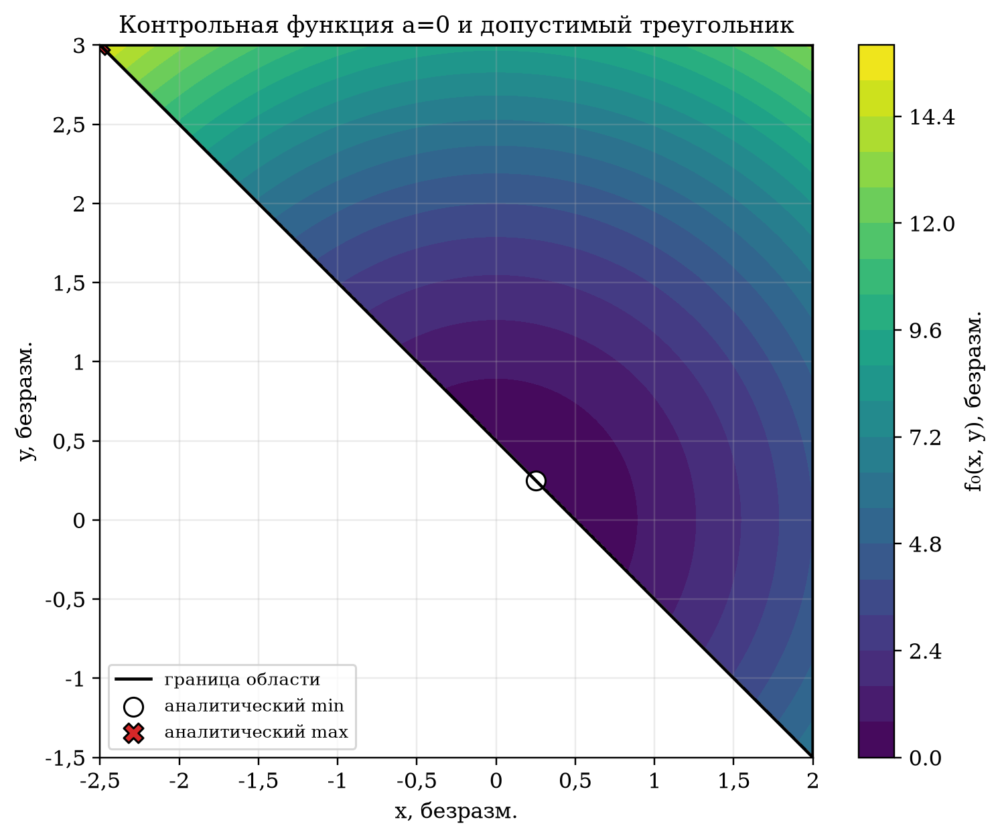
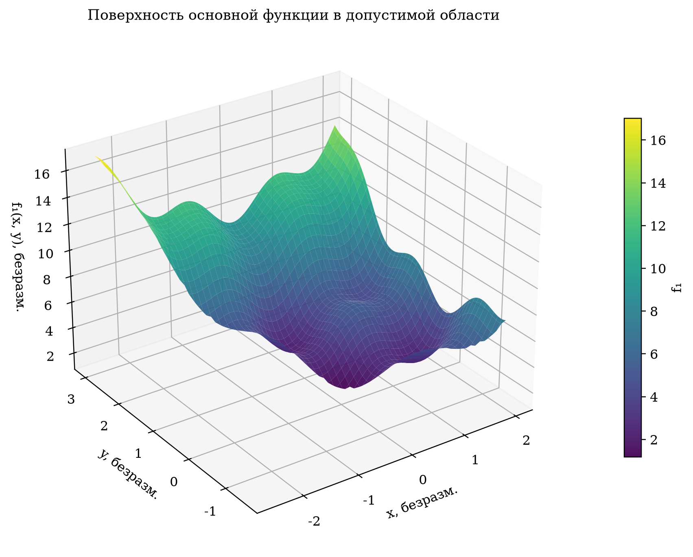
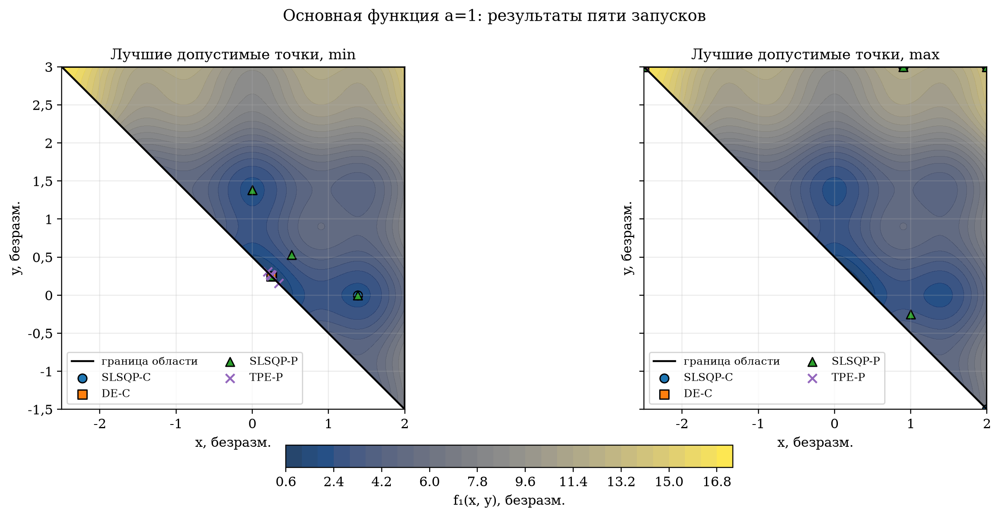
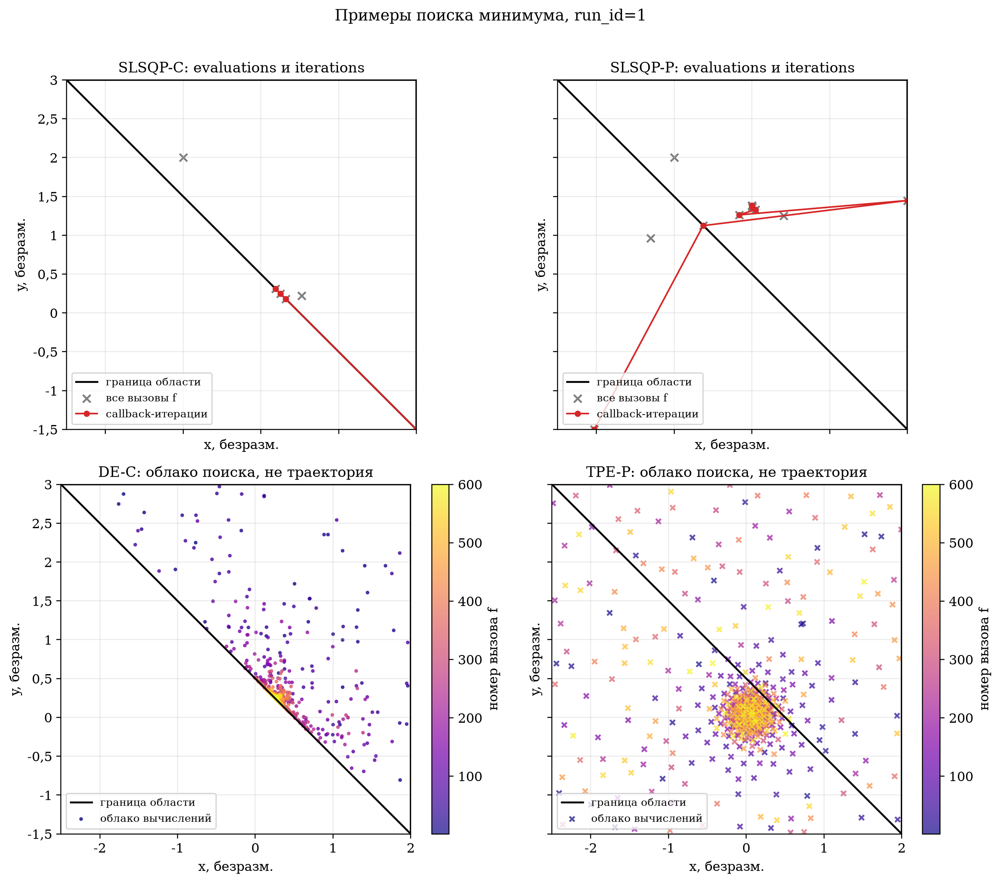
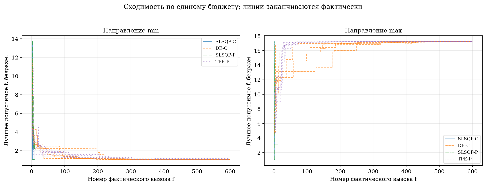
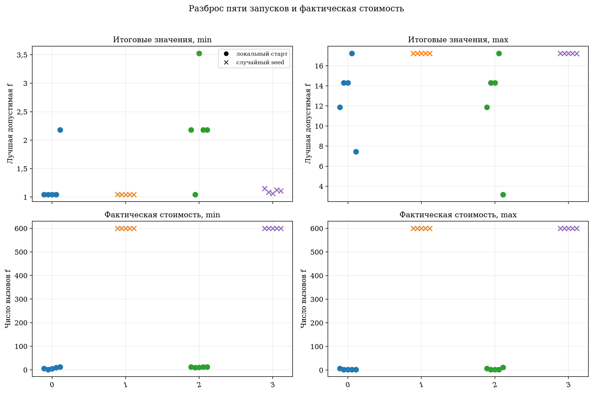
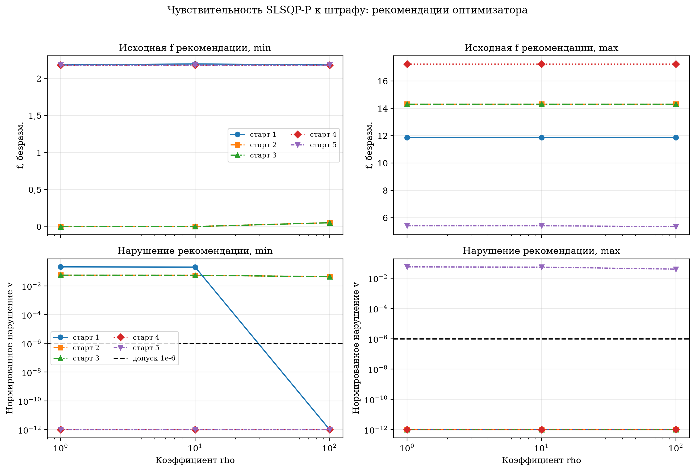

# ОТЧЁТ ПО ЛАБОРАТОРНОЙ РАБОТЕ № 2

**Московский государственный технический университет имени Н. Э. Баумана**
**Кафедра СМ6 «Ракетные и импульсные системы»**

**Дисциплина:** методы оптимизации
**Тема:** «Методы оптимизации: SciPy, Optuna и проверяемое использование LLM»

**Выполнил:** студент группы СМ6-72 Барышев А. А.
**Преподаватель:** Товарнов М. С.

Москва, 2026

## ВВЕДЕНИЕ

Цель работы — исследовать минимум и максимум модифицированной функции Растригина в треугольной области, сравнить локальный и глобальный поиск, явный и штрафной способы учёта ограничений, а также обеспечить проверяемость бюджета и использования LLM. Основной опыт выполнен при $a=1$, аналитический контроль — при $a=0$.

Сравниваются связки «алгоритм + постановка»: SLSQP-C и DE-C с явными ограничениями, SLSQP-P и TPE-P с общим штрафом. Выводы основаны на всех фактических вычислениях функции, а не только на флаге `success` или рекомендации библиотеки. Полный контракт эксперимента взят из задания [1].

## 1 Постановка задачи

Требуется исследовать минимум и максимум функции

$$
f_a(x,y)=x^2+y^2+a\left(2-\cos(4x)-\cos(4y)\right), \tag{1}
$$

где $x$, $y$ и $f$ — безразмерные величины, аргументы косинуса заданы в радианах. Основное значение параметра равно $a=1$, контрольное — $a=0$. Ограничения имеют вид

$$
x\leq 2,\qquad y\leq 3,\qquad x+y\geq 0.5. \tag{2}
$$

Пересечения граничных прямых приведены в таблице 1.

Таблица 1 — Вершины допустимой области

| Вершина | Координаты | Активные границы |
|---|---:|---|
| A | $(2;3)$ | $x=2$, $y=3$ |
| B | $(2;-1.5)$ | $x=2$, $x+y=0.5$ |
| C | $(-2.5;3)$ | $y=3$, $x+y=0.5$ |

Таким образом, область является замкнутым ограниченным треугольником и содержится в прямоугольнике $[-2.5;2]\times[-1.5;3]$. Функция (1) непрерывна, поэтому по теореме Вейерштрасса глобальные минимум и максимум на этой области существуют.

Если заменить $y\leq3$ на строгое неравенство $y<3$, область перестанет быть замкнутой и теорема Вейерштрасса больше не гарантирует достижение обоих экстремумов. В контрольной задаче минимум $(0.25;0.25)$ останется допустимым и достигнутым, но значение $15.25$ в исключённой вершине $(-2.5;3)$ станет только супремумом: к нему можно приблизиться вдоль $x+y=0.5$, но нельзя его достичь.

### 1.1 Аналитический контроль при a=0

При $a=0$ функция равна $x^2+y^2$. Начало координат нарушает третье ограничение, поскольку $0+0<0.5$. Ближайшая к началу точка полуплоскости $x+y\geq0.5$ — ортогональная проекция на прямую $x+y=0.5$. Из симметрии или условий Лагранжа следует $x=y=0.25$. Поэтому

$$
(x_{min},y_{min})=(0.25,0.25),\qquad f_{min}=0.125.
$$

Квадратичная функция выпукла. На каждом ребре её максимум достигается на одном из концов, поэтому достаточно сравнить вершины: $f(2,3)=13$, $f(2,-1.5)=6.25$, $f(-2.5,3)=15.25$. Следовательно,

$$
(x_{max},y_{max})=(-2.5,3),\qquad f_{max}=15.25.
$$

На рисунке 1 нанесены обе аналитические точки. Белая часть охватывающего прямоугольника не входит в допустимую область.



Рисунок 1 — Контрольная функция при a=0, допустимый треугольник и аналитические экстремумы

### 1.2 Градиент и его проверка

Аналитический градиент функции (1) равен

$$
\nabla f_a(x,y)=\left(2x+4a\sin(4x),\;2y+4a\sin(4y)\right). \tag{3}
$$

Он проверен центральной разностью с шагом $10^{-6}$ в точках $(0.25;0.25)$, $(-1;2)$ и $(1.3;-0.4)$. Максимальная абсолютная разность аналитической и численной компонент составила $7.110\cdot10^{-10}$, что существенно меньше принятого порога $2\cdot10^{-8}$. Эти диагностические вычисления выполнялись командой `check` отдельно от бюджетов оптимизаторов.

Поверхность при $a=1$ на рисунке 2 демонстрирует несколько локальных впадин и подъёмов. Поэтому успех локального метода означает выполнение его критерия остановки, но не доказывает глобальность. Глобальные стохастические методы исследуют область шире, однако конечный бюджет также не даёт математического доказательства глобального экстремума.



Рисунок 2 — Поверхность основной функции при a=1 в допустимой области

### 1.3 Остатки, допустимость и штраф

Использованы заданные нормированные остатки

$$
g_1=\frac{x-2}{4.5},\qquad
g_2=\frac{y-3}{4.5},\qquad
g_3=\frac{0.5-x-y}{9}. \tag{4}
$$

Численное нарушение определено как $v=\max(0,g_1,g_2,g_3)$. Точка признавалась допустимой при $v\leq10^{-6}$ до округления. Для максимизации и минимизации использована единая минимизируемая цель

$$
J_s=s f_a,\qquad
F_s=s f_a+\rho P,\qquad
P=\sum_{i=1}^{3}\max(0,g_i)^2, \tag{5}
$$

где $s=+1$ для минимума, $s=-1$ для максимума, $\rho$ — коэффициент штрафа. Внутри `Bounds` первые два вклада $P$ равны нулю, однако они сохранены для единого вектора проверок. Конечное $\rho$ не превращает штраф в строгое ограничение: уменьшение $s f_a$ может компенсировать ненулевой штраф, поэтому рекомендация штрафного оптимизатора проверяется на допустимость отдельно.

## 2 Методы и план эксперимента

Реализация выполнена как непакетный скрипт `main.py` под управлением `uv`. Настройки методов перечислены в таблице 2 и зафиксированы вместе с версиями библиотек в `results/config.json`. Интерфейсы SciPy сверены с документацией [2–4], TPESampler — с документацией Optuna [5].

Таблица 2 — Обязательные методы

| Код | Реализация | Учёт ограничений | Основные настройки |
|---|---|---|---|
| SLSQP-C | `scipy.optimize.minimize` | `Bounds` и явное $x+y\geq0.5$ | `maxiter=10000`, `ftol=1e-9`, аналитический градиент |
| DE-C | `differential_evolution` | `Bounds`, `LinearConstraint` | `popsize=15`, `tol=atol=0`, `polish=False`, `workers=1` |
| SLSQP-P | `minimize`, SLSQP | только `Bounds`, функция (5) | те же настройки SLSQP, аналитический градиент штрафованной цели |
| TPE-P | `TPESampler` | `Bounds` и функция (5) | `n_startup_trials=20`, `n_jobs=1`, без pruning |

SLSQP-P намеренно не получает явное ограничение $x+y\geq0.5$. Один trial TPE-P содержит только равномерные непрерывные `suggest_float` для $x$ и $y$ и один вызов $F_s$; вложенного оптимизатора нет.

### 2.1 Запуски и бюджет

Пять `run_id` связывают заданный seed стохастического метода с заданным стартом локального метода, но не образуют декартово произведение. План приведён в таблице 3.

Таблица 3 — Соответствие run_id, seed и начальной точки

| run_id | seed DE/TPE | Старт SLSQP |
|---:|---:|---:|
| 1 | 11 | $(-1;2)$ |
| 2 | 23 | $(0.25;0.25)$ |
| 3 | 37 | $(1.5;2.5)$ |
| 4 | 51 | $(-2;2.75)$ |
| 5 | 71 | $(1;-0.25)$ |

Основной опыт содержит $2\times4\times5=40$ запусков при $a=1$ и $\rho=100$ для штрафных методов. Исследование штрафа добавляет 20 запусков SLSQP-P при $\rho=1$ и $10$; строки $\rho=100$ переиспользуются из основной фазы. Контроль содержит восемь запусков при $a=0$. Итого выполнено 68 независимых запусков.

Для каждого запуска установлен cap $B=600$ фактических скалярных вычислений $f$. Объект `BudgetedObjective` перед каждым вычислением проверяет счётчик и при исчерпании cap возбуждает контролируемое исключение, не возвращая фиктивного значения. Аналитические градиенты учитываются отдельно и не расходуют бюджет. Истории `evaluations.csv` и `iterations.csv` различаются: первая содержит все реальные оценки, вторая — координаты на callback SLSQP без дополнительного вызова $f$.

После полного запуска файлы перечитаны валидатором. Получены 68 строк запусков, 14 709 оценок, 229 callback-итераций SLSQP и 7 200 завершённых Optuna trials. Все `eval_id` начинаются с единицы внутри своего запуска, все `run_key` уникальны, а превышений 600 нет. Повторная команда `run` строит данные в памяти и полностью заменяет основные журналы, не дописывая строки к старому опыту.

## 3 Сохранённые данные и воспроизводимость

Файл `results/evaluations.csv` хранит исходную $f$, фактическую цель, координаты, остатки, штраф, нарушение, допустимость и время каждой оценки. `runs.csv` отдельно хранит рекомендацию оптимизатора и лучшую допустимую точку по всей истории. Для DE-C, остановленного контролируемым исключением по cap, библиотечная рекомендация отсутствует и поля оставлены пустыми; лучшая допустимая оценка при этом сохранена. Пустое поле означает неприменимость или отсутствие, а не ноль.

Основные команды воспроизведения:

```bash
uv sync --frozen
uv run python main.py check
uv run python main.py run
uv run python main.py report
```

`check` не запускает полный опыт. `run` выполняет 68 запусков без LLM/API. `report` перечитывает CSV, валидирует связи, пересоздаёт таблицы и рисунки без нового поиска. После `report` основные журналы не изменились; это дополнительно контролировалось по состоянию Git и SHA-256. Версии среды: Python 3.12.14, NumPy 2.5.4, SciPy 1.18.1, Optuna 5.0.0, Matplotlib 3.11.2.

## 4 Результаты

### 4.1 Основной случай a=1

На рисунке 3 показана карта функции и лучшие допустимые точки каждого запуска. Карта служит предварительным представлением и не используется как доказательство точного глобального решения. Наилучшие наблюдаемые значения получены около $(0.25;0.25)$ для минимума и в вершине $(-2.5;3)$ для максимума. В этих точках исходные ограничения дают соответственно $x+y=0.5$ и одновременно $y=3$, $x+y=0.5$; нормированное нарушение равно нулю до вычислительной точности.



Рисунок 3 — Карта основной функции и лучшие допустимые точки пяти запусков

Сводка по исходной $f$ приведена в таблице 4. «Худшее» означает худшее среди пяти лучших допустимых результатов, а не значение штрафованной цели.

Таблица 4 — Сводка основного опыта при a=1

| Направление | Метод | Допустимо | Лучшее f | Медиана f | Худшее f | Среднее n_eval |
|---|---|---:|---:|---:|---:|---:|
| min | SLSQP-C | 5/5 | 1.04439539 | 1.04439539 | 2.18176120 | 6.6 |
| min | DE-C | 5/5 | 1.04439985 | 1.04449358 | 1.04544001 | 600.0 |
| min | SLSQP-P | 5/5 | 1.04439539 | 2.18176120 | 3.52668964 | 11.0 |
| min | TPE-P | 5/5 | 1.06228372 | 1.10689200 | 1.15040141 | 600.0 |
| max | SLSQP-C | 5/5 | 17.24521757 | 14.30164608 | 7.43532975 | 3.0 |
| max | DE-C | 5/5 | 17.24494852 | 17.23890688 | 17.23140484 | 600.0 |
| max | SLSQP-P | 5/5 | 17.24521757 | 14.30164608 | 3.17584131 | 4.8 |
| max | TPE-P | 5/5 | 17.24018397 | 17.22705291 | 17.22136383 | 600.0 |

Все методы хотя бы раз нашли допустимые точки во всех пяти запусках, но устойчивость различается. SLSQP-C и SLSQP-P часто завершались за 1–12 оценок, однако их итог сильно зависел от старта. DE-C и TPE-P использовали весь cap; их результаты по максимуму образовали существенно более узкий диапазон. При данном бюджете DE-C оказался ближе к лучшему наблюдаемому минимуму, чем TPE-P, но из одного протокола нельзя выводить обязательное превосходство алгоритма в других задачах.

Рисунок 4 поясняет структуру истории. Серые кресты — все оценки SLSQP, красная линия — только принятые callback-итерации. Для DE-C и TPE-P показаны облака проб по номеру вычисления; они не интерпретируются как траектории локального спуска.



Рисунок 4 — Различие evaluation trace, iteration trace и облаков стохастического поиска

Лучшее допустимое значение после каждого фактического вызова показано на рисунке 5. До первой допустимой оценки значение отсутствует, а короткие линии SLSQP не продолжены искусственно до 600.



Рисунок 5 — Лучшее допустимое значение по номеру фактического вызова функции

Рисунок 6 объединяет разброс результата и стоимость. Кругами обозначены разные фиксированные старты локальных методов, крестами — независимые seeds стохастических методов. Равный cap не означает равную фактическую стоимость: раннее завершение SLSQP является допустимым исходом протокола.



Рисунок 6 — Разброс пяти запусков и фактическое число вычислений функции

### 4.2 Исследование коэффициента штрафа

Рисунок 7 показывает именно рекомендации SLSQP-P, а не лучшие допустимые записи. При минимизации для старта 2 рекомендация при $\rho=1$ имеет $f=8.42\cdot10^{-6}$, но нарушение $v=0.055404$, поэтому не может сравниваться с допустимыми итогами. Даже при $\rho=100$ нарушение этого старта равно $0.043530$. Для максимизации старт 5 остаётся недопустимым при всех трёх коэффициентах: $v$ уменьшается от $0.055333$ до $0.039242$. Для других стартов рекомендации могут быть допустимыми уже при $\rho=1$.



Рисунок 7 — Исходная функция и нарушение рекомендаций SLSQP-P при разных rho

Результат подтверждает две оговорки. Во-первых, конечное $\rho$ не гарантирует допустимость. Во-вторых, зависимость не обязана быть монотонной между локальными бассейнами. Поэтому сравнение методов в таблице 4 выполнено по лучшей допустимой исходной $f$ всей истории, а не по $F_s$ или недопустимой рекомендации.

### 4.3 Контроль a=0

В таблице 5 вычислительные результаты сопоставлены с аналитическими значениями $0.125$ и $15.25$.

Таблица 5 — Ошибка лучшей допустимой оценки в контрольной задаче

| Направление | Метод | Лучшая f | Абсолютная ошибка | n_eval | Причина остановки |
|---|---|---:|---:|---:|---|
| min | SLSQP-C | 0.12500000 | $2.78\cdot10^{-17}$ | 6 | converged |
| min | DE-C | 0.12500413 | $4.13\cdot10^{-6}$ | 600 | budget_reached |
| min | SLSQP-P | 0.65028868 | $5.25\cdot10^{-1}$ | 8 | converged |
| min | TPE-P | 0.13086903 | $5.87\cdot10^{-3}$ | 600 | budget_reached |
| max | SLSQP-C | 15.25000000 | 0 | 2 | converged |
| max | DE-C | 15.23908336 | $1.09\cdot10^{-2}$ | 600 | budget_reached |
| max | SLSQP-P | 15.25000000 | 0 | 2 | converged |
| max | TPE-P | 15.24172827 | $8.27\cdot10^{-3}$ | 600 | budget_reached |

SLSQP-C воспроизвёл оба аналитических ответа, SLSQP-P — контрольный максимум. Штрафной минимум SLSQP-P завершился на недопустимой рекомендации с $v=0.016014$; приведённое в таблице значение $0.650289$ — не эта рекомендация, а лучшая допустимая оценка истории. DE-C и TPE-P не обязаны точно достигнуть аналитической точки за 600 оценок; их ненулевые ошибки честно сохранены и не указывают сами по себе на ошибку реализации.

## 5 Обсуждение и самопроверка

Эксперимент показывает, что локальные методы экономны по вызовам, но чувствительны к старту и локальным экстремумам. Стохастические DE-C и TPE-P дали более устойчивые результаты по максимуму ценой полного бюджета. Сравнение SLSQP-C и SLSQP-P демонстрирует влияние постановки ограничений: штраф может привести к недопустимой рекомендации даже при библиотечном `success=True`. Сравнение DE-C с SLSQP-C и TPE-P с SLSQP-P нельзя сводить только к названию алгоритма, поскольку внутри каждой пары сохраняется соответствующий способ учёта ограничений.

Наилучшие наблюдаемые значения $1.04439539$ и $17.24521757$ согласуются с картой и несколькими независимыми запусками, но глобальность при $a=1$ не объявляется доказанной. Ни сетка, ни `success=True`, ни конечный стохастический поиск не являются таким доказательством. Отсутствие библиотечной рекомендации DE-C связано со штатным исключением при cap, а не с потерей его истории.

Самопроверка включала: аналитические подстановки; центральную разность для градиента; проверку знака цели; тест штрафа и его градиента; синтетический cap; контроль состава 68 запусков; повторное чтение CSV и проверку каждой ссылки `best_eval_id`; проверку равенства числа TPE-оценок и trials. Команда `report` не вызывает оптимизаторы и не использует LLM/API.

### 5.1 Использование LLM

Работа выполнялась в агентской среде OpenCode с моделью GPT-5.6 Sol. Полный чат не включается в сдачу; ниже приведены два проверяемых эпизода, подробная копия формы находится в `review_llm_protocol.md`.

1. При сверке документов LLM обнаружила ошибочное указание `(0,0)` в старой дорожной карте. Независимая подстановка дала $g_3=0.055555>10^{-6}$, после чего принята точка $(0.25;0.25)$. Решение подтверждено аналитикой и командой `check`.
2. Для честного бюджета LLM предложила обёртку с проверкой cap до вызова. Малый тест $B=2$ остановил третью попытку, а валидатор полного опыта подтвердил 68 запусков, 14 709 оценок и отсутствие превышений. Предложение принято вместе с раздельным хранением рекомендации и лучшей допустимой оценки.

Проверки являются прямыми вычислениями и чтением журналов, а не повторным вопросом модели. LLM не вызывается во время эксперимента.

## ЗАКЛЮЧЕНИЕ

Реализован воспроизводимый эксперимент для минимума и максимума модифицированной функции Растригина в треугольной области. Аналитический контроль при $a=0$ подтвердил постановку и выявил ожидаемые различия методов при конечном бюджете. В основном опыте все связки нашли допустимые точки во всех пяти запусках; локальные методы потребовали меньше вычислений, но показали сильную зависимость от старта, тогда как DE-C и TPE-P использовали cap и дали более устойчивые максимумы.

Штрафной эксперимент подтвердил, что конечный коэффициент штрафа не гарантирует допустимость рекомендации. Поэтому итоговое сравнение выполнено по исходной функции лучшей допустимой точки всей истории. Журналы, seeds, настройки, версии, рисунки и таблицы сохранены; команды `check`, `run` и `report` не требуют интерактивного ввода или доступа к LLM.

## СПИСОК ИСПОЛЬЗОВАННЫХ ИСТОЧНИКОВ

1. Лабораторная работа № 2. Методы оптимизации: SciPy, Optuna и проверяемое использование LLM. Версия комплекта 1.0. Файл `Sources/01_assignment.md`.
2. SciPy 1.18.1. `minimize(method='SLSQP')` — документация. URL: <https://docs.scipy.org/doc/scipy/reference/optimize.minimize-slsqp.html> (дата обращения: 24.10.2026).
3. SciPy 1.18.1. `differential_evolution` — документация. URL: <https://docs.scipy.org/doc/scipy/reference/generated/scipy.optimize.differential_evolution.html> (дата обращения: 24.10.2026).
4. SciPy 1.18.1. `LinearConstraint` — документация. URL: <https://docs.scipy.org/doc/scipy/reference/generated/scipy.optimize.LinearConstraint.html> (дата обращения: 24.10.2026).
5. Optuna 5.0.0. `TPESampler` — документация. URL: <https://optuna.readthedocs.io/en/stable/reference/samplers/generated/optuna.samplers.TPESampler.html> (дата обращения: 24.10.2026).
6. ГОСТ 7.32–2017. Отчёт о научно-исследовательской работе. Структура и правила оформления. URL: <https://dd.hse.ru/mirror/pubs/share/902555672> (дата обращения: 24.10.2026).

## ПРИЛОЖЕНИЕ А

**(обязательное)**

**Текст программы вычислительного эксперимента**

Полный исполняемый файл `main.py` входит в электронное приложение к отчёту. Ключевые функции программы:

```text
raw_function, raw_gradient          — функция и аналитический градиент;
normalized_residuals, penalty       — остатки и единый штраф;
BudgetedObjective                   — cap и журнал фактических оценок;
run_scipy_method                    — SLSQP-C, DE-C и SLSQP-P;
run_optuna_method                   — последовательный TPE-P;
validate_saved_results              — независимая проверка CSV;
generate_report_artifacts           — таблицы и рисунки без поиска.
```

Файл `uv.lock` фиксирует среду, а `results/config.json` — вычислительный контракт и все 68 спецификаций запуска.
